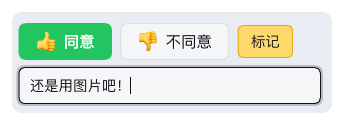

<p align="center">
  
</p>

<h1 align="center">dsh-popup</h1>

<p align="center">在 DeepSeek Harness 里选中文字，就地回答，答案自动变成引用草稿。</p>

<p align="center">
  <a href="https://github.com/GioStarLC/dsh-popup/actions/workflows/check.yml"></a>
  <a href="LICENSE"></a>
  
</p>

读完一段想回应，通常要先选中、复制、切到输入框、粘贴、加引用符号，再写自己的话。dsh-popup 把这套动作收回阅读现场：选中 → 回答 → 继续读，草稿已经写好。

<p align="center"></p>

## 功能

- 选中助手回复里的文字，旁边出现一个小气泡按钮
- 悬停或点击打开卡片：👍 同意、👎 不同意、标记，或自己写一句
- 回答过的段落以 `> 原文` + `我的回答：…` 进入草稿；标记只留在页面上，不进消息
- 只对最新一条助手回复生效，更早的选区不会出现入口
- 消息发出后仍可取消标记，并把对应的引用从草稿里撤回
- 无构建、无运行时依赖、不联网

## 安装

需要支持客户端插件的 DSH。

```sh
dsh plugin --profile web add github:GioStarLC/dsh-popup
```

或者克隆到本地，装本地路径：

```sh
git clone https://github.com/GioStarLC/dsh-popup.git
```

```
plugin_manager install_bundle target=/absolute/path/to/dsh-popup
```

重启应用或刷新窗口，无需构建。

## 用法

| 你做的 | 它做的 |
| --- | --- |
| 选中最新回复里的文字 | 旁边出现气泡按钮 |
| 悬停 160ms 或点击 | 在落点打开卡片，光标进注输入框 |
| 点 👍 同意 / 👎 不同意 / 标记，或写一句 | 存进当前会话 |
| 点进空的输入框 | 引用与回答自动写进草稿 |

<p align="center"></p>

```markdown
> 第一步：用 Redis
> 运维成本高
我的回答：这条我认同
```

`我的回答：` 让这一行不被读成上面引用的延续。自动填入默认开启，可在输入框工具行关掉；已经有字的草稿不会被改动。

标记过的段落可以随时点回来改答案，或取消标记。

## 开发

```sh
npm install
npx playwright install chromium
npm run check
```

两项检查都要跑。设计取舍与实现细节见 [docs/design.md](docs/design.md)，贡献说明见 [CONTRIBUTING.md](CONTRIBUTING.md)。

## 许可

[MIT](LICENSE) © GioStarLC

非官方插件，与 DeepSeek 无隶属关系，也未获其背书。“DeepSeek”和“DeepSeek Harness”仅用于说明它所接入的应用。
